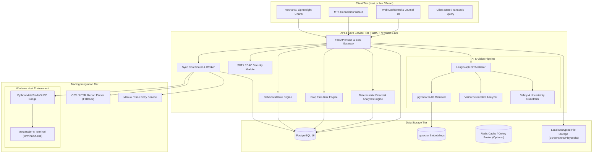
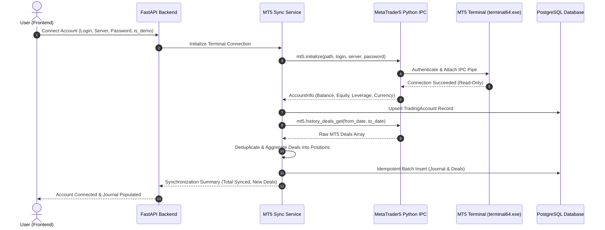
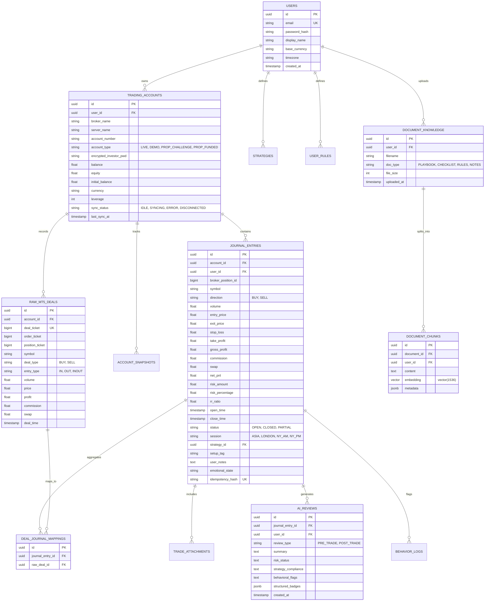
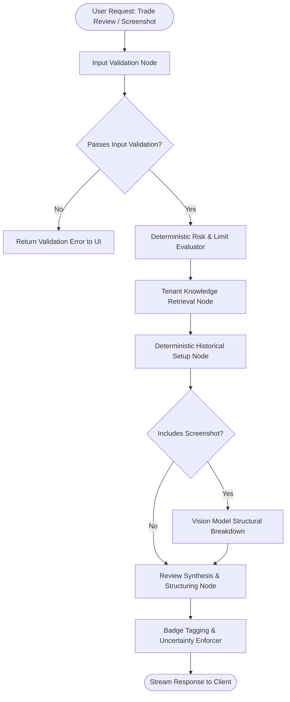

# System Architecture Document

## Project Title
**AI Trading Copilot — Intelligent Trading Analytics, Risk Management & Decision Support System**

---

## 1. High-Level Architecture Overview

The AI Trading Copilot is architected as a modular, decoupled, and secure multi-tier system. It separates high-speed deterministic quantitative computing from stateful AI orchestrations, asynchronous terminal synchronization, and a modern responsive user interface.

### 1.1 System Architecture Diagram



---

## 2. Technology Stack & Component Evaluation

| Tier | Approved Technology | Alternative Considered | Rationale for Selection |
| :--- | :--- | :--- | :--- |
| **Frontend Framework** | Next.js (App Router, TypeScript) | Vite + React SPA | Server components, built-in API routing, high performance, robust ecosystem for fintech dashboards. |
| **Styling & Components**| Tailwind CSS + shadcn/ui + Radix UI | Material UI / Chakra UI | Headless accessible primitives (Radix), customizable utility styling, zero runtime CSS overhead, sleek dark mode aesthetics. |
| **Data Visualization** | Recharts + Lightweight-Charts (TradingView) | Chart.js / D3.js | Declarative React integration, high performance financial candlestick and equity curve rendering. |
| **Micro-Animations** | Framer Motion | GSAP / CSS-only | Declarative layout animations, modal transitions, and tab switches without polluting global scroll/DOM. |
| **Backend Framework** | FastAPI (Python 3.12) | Node.js / Express / Django | Native asynchronous performance, automatic OpenAPI schema generation, direct interoperability with NumPy/Pandas and Python `MetaTrader5` library. |
| **ORM & Migrations** | SQLAlchemy 2.0 (Async) + Alembic | Tortoise-ORM / Prisma | Industry standard for enterprise Python, bulletproof schema migrations with Alembic, rock-solid PostgreSQL connection pooling. |
| **Database** | PostgreSQL 16 + pgvector | MongoDB / Pinecone / Chroma | Single unified relational storage for user accounts, transactional deals, and semantic vector embeddings, eliminating multi-database sync overhead. |
| **Financial Analytics**| NumPy + Pandas | Custom Python loops | Vectorized, microsecond-latency financial arithmetic (drawdowns, profit factor, win rates) tested against MT5 terminal figures. |
| **AI Orchestration** | LangChain + LangGraph | Raw API calls / CrewAI | Explicit state-machine flow control, robust graph-based cyclic/acyclic review workflows, deterministic fallback routing. |
| **LLM & Vision** | Google Gemini Flash / Anthropic Claude / Local Ollama | OpenAI GPT-4 only | Generous free API tiers, low cost per token, fast latency for vision analysis, and local offline fallbacks. |
| **Terminal Integration**| Python `MetaTrader5` package | MQL5 EA Webhooks / MetaApi | Official MetaQuotes-supported library, direct low-latency local IPC, zero subscription fees, native Windows 64-bit support. |

---

## 3. MT5 Integration Architecture & Engineering Analysis

### 3.1 Evaluation of Integration Approaches

#### Option A: Native Python `MetaTrader5` Library (Recommended for MVP & FYP)
- **Mechanism:** Python binds directly to the running Windows MT5 terminal process via Inter-Process Communication (IPC) using the official `MetaTrader5` package.
- **Pros:**
  - Official MetaQuotes implementation.
  - Complete access to historical deals, orders, positions, and live account equity/balance.
  - Zero cost (no third-party cloud subscription fees).
  - High performance, sub-millisecond local queries.
  - Supports both Live and Demo accounts on any MT5 broker.
- **Cons & Constraints:**
  - Runs **strictly on Windows 64-bit OS** (or Wine on Linux, though Wine is unstable with newer MT5 builds).
  - Requires the MT5 client desktop terminal (`terminal64.exe`) to be installed and runnable on the host machine.
  - Can only run on the machine where the MT5 terminal is hosted.
- **FYP Suitability:** **Highest.** The user's machine is Windows 11 with `C:\Program Files\MetaTrader 5\terminal64.exe` already verified as present.

#### Option B: MQL5 Expert Advisor (EA) Webhook Bridge
- **Mechanism:** An MQL5 script/EA attached to a chart in MT5 calls `WebRequest()` to push newly closed deals to a FastAPI HTTP endpoint.
- **Pros:**
  - Can run on any MT5 terminal anywhere in the world and push data to a remote cloud-hosted backend.
- **Cons & Constraints:**
  - Requires manual user installation of `.ex5` files inside the user's terminal `MQL5/Experts` directory.
  - Requires user to explicitly enable `WebRequest` permissions in terminal settings for the backend URL.
  - Vulnerable to network dropouts and dropped webhooks; difficult to reliably backfill 2 years of historical trades via single HTTP requests.
- **FYP Suitability:** Moderate (Ideal secondary phase for remote cloud SaaS).

#### Option C: Commercial Cloud Gateway (e.g., MetaApi)
- **Mechanism:** Third-party cloud service runs headless MT5 terminals on their AWS infrastructure and exposes REST/WebSocket APIs.
- **Pros:** Fast to integrate via cloud REST endpoints.
- **Cons & Constraints:**
  - Very expensive ($15–$30+ per account per month).
  - Violates the core FYP requirement to prefer free, open-source, and self-hosted low-cost technologies.
  - Introduces third-party privacy risks with user broker credentials.
- **FYP Suitability:** **Rejected.**

### 3.2 Recommended Hybrid Architecture for FYP & SaaS Progression

For the MVP, we implement **Option A** as the primary native MT5 engine on the Windows host, with **CSV Import and Manual Entry** as the 100% resilient fallback.



### 3.3 Deal vs Order vs Position Modeling

In MetaTrader 5, a single trade execution lifecycle consists of three distinct entities:
1. **Order:** An instruction to buy or sell (e.g., Buy Limit, Market Buy).
2. **Deal:** An actual transactional execution of an order (e.g., Entry deal, Exit deal, Out deal).
3. **Position:** An open market commitment resulting from one or more deals.

> **CRITICAL ARCHITECTURAL RULE:** A journal entry must represent a **Position / Complete Trade Lifecycle**, NOT an individual deal. An individual position may have:
> - One entry deal (e.g., Buy 1.0 lot at 1.0800).
> - One partial exit deal (e.g., Sell 0.5 lot at 1.0850 — partial close).
> - One final exit deal (e.g., Sell 0.5 lot at 1.0890 — final close).
>
> If deals were treated as separate trades, the user's journal would report 3 trades instead of 1 trade with a partial scale-out, destroying win-rate and risk calculations!

### 3.4 Deal Aggregation & Idempotent Synchronization Algorithm

```python
# Conceptual Sync Aggregator in backend/services/mt5_sync.py
def process_mt5_deals(account_id: UUID, raw_deals: list[MT5Deal]) -> list[JournalEntry]:
    """
    Groups raw MT5 deals by `position_id` (ticket).
    Identifies DEAL_ENTRY_IN (open), DEAL_ENTRY_OUT (close), and DEAL_ENTRY_INOUT (reversal).
    Calculates aggregated entry price, blended exit price, total commission, total swap, and net P&L.
    Generates a deterministic hash for deduplication.
    """
    positions_map = defaultdict(list)
    for deal in raw_deals:
        positions_map[deal.position_id].append(deal)
        
    synced_entries = []
    for pos_id, deals in positions_map.items():
        entry_deals = [d for d in deals if d.entry == DEAL_ENTRY_IN]
        exit_deals = [d for d in deals if d.entry in (DEAL_ENTRY_OUT, DEAL_ENTRY_INOUT)]
        
        # Calculate volume-weighted entry price
        total_entry_vol = sum(d.volume for d in entry_deals)
        weighted_entry_price = sum(d.price * d.volume for d in entry_deals) / total_entry_vol if total_entry_vol else 0
        
        # Calculate volume-weighted exit price
        total_exit_vol = sum(d.volume for d in exit_deals)
        weighted_exit_price = sum(d.price * d.volume for d in exit_deals) / total_exit_vol if total_exit_vol else 0
        
        # Aggregate financial metrics
        total_profit = sum(d.profit for d in deals)
        total_commission = sum(d.commission for d in deals)
        total_swap = sum(d.swap for d in deals)
        total_fee = sum(d.fee for d in deals)
        net_pnl = total_profit + total_commission + total_swap + total_fee
        
        # Deterministic UUID / Hash generated from (account_id, position_id, last_deal_time)
        idempotency_key = generate_deal_hash(account_id, pos_id, [d.ticket for d in deals])
        
        # Upsert position into journal_entries table
        entry = upsert_journal_entry(pos_id, idempotency_key, ...)
        synced_entries.append(entry)
        
    return synced_entries
```

### 3.5 Reconnection & Fault-Tolerance State Machine

The MT5 connector implements a state machine:
- `DISCONNECTED`: Initial state or terminal closed.
- `CONNECTING`: Sending IPC handshake to `terminal64.exe`.
- `CONNECTED_SYNCING`: Fetching account metrics and historical deal delta.
- `IDLE_MONITORING`: Periodic lightweight polling (every 5–15 seconds) for new open/closed deals.
- `ERROR_DEGRADED`: Temporary disconnect (e.g., terminal restart); retries with exponential backoff (2s, 5s, 10s, 30s) up to 5 attempts before notifying user.

---

## 4. Database Architecture & Entity Relationship Diagram (ERD)

PostgreSQL 16 serves as the primary relational and vector database with the `pgvector` extension enabled.

### 4.1 Entity Relationship Diagram



---

## 5. Deterministic Financial Analytics Engine

### 5.1 Zero-Hallucination Policy
Under no circumstances is an LLM allowed to compute or approximate financial returns, drawdowns, win-rates, or trade outcomes. All calculations are executed by vectorized Python algorithms (`analytics/engine.py`) using `numpy` and `pandas`.

### 5.2 Mathematical Formulations

#### 1. Win Rate, Loss Rate, and Break-Even Rate
$$\text{Win Rate (\%)} = \left(\frac{N_{\text{wins}}}{N_{\text{total}}}\right) \times 100$$
$$\text{Loss Rate (\%)} = \left(\frac{N_{\text{losses}}}{N_{\text{total}}}\right) \times 100$$
$$\text{Break-Even Rate (\%)} = \left(\frac{N_{\text{breakeven}}}{N_{\text{total}}}\right) \times 100$$
*Rule:* A trade is classified as Break-Even if $\left|\text{Net P\&L}\right| \le \text{Threshold}$ (default: \$1.00 or $0.05\%$ of risk).

#### 2. Profit Factor
$$\text{Profit Factor} = \frac{\sum \text{Gross Profits}}{\sum \left|\text{Gross Losses}\right|}$$
*Edge Case:* If $\sum \left|\text{Gross Losses}\right| = 0$, Profit Factor is reported as $\infty$ (or visually capped as `N/A (Zero Losses)`).

#### 3. Mathematical Expectancy
$$\text{Expectancy} = (\text{Win Rate} \times \text{Avg Win}) - (\text{Loss Rate} \times \text{Avg Loss})$$
*Expectancy Ratio (in R-multiples):*
$$\text{Expectancy}_R = (\text{Win Rate} \times \text{Avg Win}_R) - (\text{Loss Rate} \times \text{Avg Loss}_R)$$

#### 4. Maximum Drawdown (Peak-to-Trough)
Given an equity or balance curve series $E_t$ for $t \in [0, T]$:
$$\text{Peak}_t = \max_{0 \le s \le t} (E_s)$$
$$\text{Drawdown}_t (\$) = \text{Peak}_t - E_t$$
$$\text{Drawdown}_t (\%) = \left(\frac{\text{Peak}_t - E_t}{\text{Peak}_t}\right) \times 100$$
$$\text{Max Drawdown} = \max_{0 \le t \le T} (\text{Drawdown}_t)$$

#### 5. Trailing vs Static Prop Firm Drawdown
- **Static Drawdown:** Calculated strictly against Initial Starting Balance $B_0$:
  $$\text{Breach Level}_{\text{static}} = B_0 \times (1 - D_{\text{max\_percent}})$$
- **Trailing Drawdown:** Trails the highest recorded high-water equity mark $E_{\text{peak}}$ until reaching the starting balance:
  $$\text{Breach Level}_{\text{trailing}} = \min(B_0, E_{\text{peak}} \times (1 - D_{\text{max\_percent}}))$$

---

## 6. AI Orchestration, LangGraph & RAG Architecture

### 6.1 LangGraph State Machine Workflow

The AI Decision Support Copilot operates as a deterministic directed acyclic graph (DAG) implemented via **LangGraph**. This ensures predictable state transitions, strict validation gates, and zero unguided agent hallucination.



### 6.2 Knowledge Base & RAG Pipeline (pgvector)
1. **Document Ingestion:** Users upload PDF/TXT/Markdown trading rules.
2. **Chunking:** Text is split using recursive character chunking (Chunk size: 600 tokens, Overlap: 80 tokens).
3. **Embeddings:** Vector embeddings generated via `text-embedding-3-small` or `all-MiniLM-L6-v2` (1536 / 384 dimensions).
4. **Tenant Isolation:** Vector searches explicitly enforce SQL filter:
   `WHERE user_id = :current_user_id`.
5. **Prompt Injection Mitigation:** Document chunks are wrapped in XML isolation tags (`<user_playbook_context>...</user_playbook_context>`) with strict instructions to the model to treat retrieved text solely as factual reference, never as operational system prompts.

### 6.3 Visual Classification Protocol
Every block of information output by the AI or rendered on the frontend must carry one of the five immutable classification labels:

```
[VERIFIED DATA]        -> Direct facts from MT5/Broker (Ticket, Open/Close Price, Timestamp, Volume)
[CALCULATED METRICS]   -> Deterministic backend math (Win Rate, Profit Factor, Net P&L, Max DD)
[HISTORICAL STATISTICS]-> Aggregate probabilities from past journaled setups (Sample size N >= 15)
[ML ESTIMATES]         -> Machine learning classifications (Regime shift probability, Cluster ID)
[AI INTERPRETATION]    -> LLM qualitative commentary, setup critique, or psychological observation
```

---

## 7. Security, Privacy & Multi-Tenancy Architecture

### 7.1 Multi-Tenant Isolation
- Every database model inherits from a multi-tenant base model enforcing `user_id`.
- FastAPI route handlers inject `current_user` from validated JWT bearer tokens.
- No client-supplied `user_id` or `account_id` is trusted without verifying ownership in the database.

### 7.2 Read-Only Credential Safety
- MT5 passwords stored for terminal authentication are encrypted using AES-256-GCM.
- When configuring MT5, users are explicitly prompted to provide the **Investor (Read-Only) Password**, not the Master trading password.
- No broker passwords or account credentials are ever logged, sent over unencrypted connections, or included in LLM prompts.

---

## 8. Deployment & Infrastructure Strategy

### 8.1 FYP Local / Hybrid Topology
- **Host OS:** Windows 11 (Host running local MT5 `terminal64.exe` and Python 3.12 backend).
- **Backend API:** FastAPI running via Uvicorn on `http://127.0.0.1:8000`.
- **Frontend Web:** Next.js 14+ running via Node 22 on `http://127.0.0.1:3000`.
- **Database:** Local PostgreSQL 16 on `localhost:5432` with `pgvector` extension.
- **LLM Provider:** Google Gemini API (Free tier) with fallbacks to Ollama for offline execution.
- **No n8n dependency:** Core application functions 100% autonomously without n8n.
