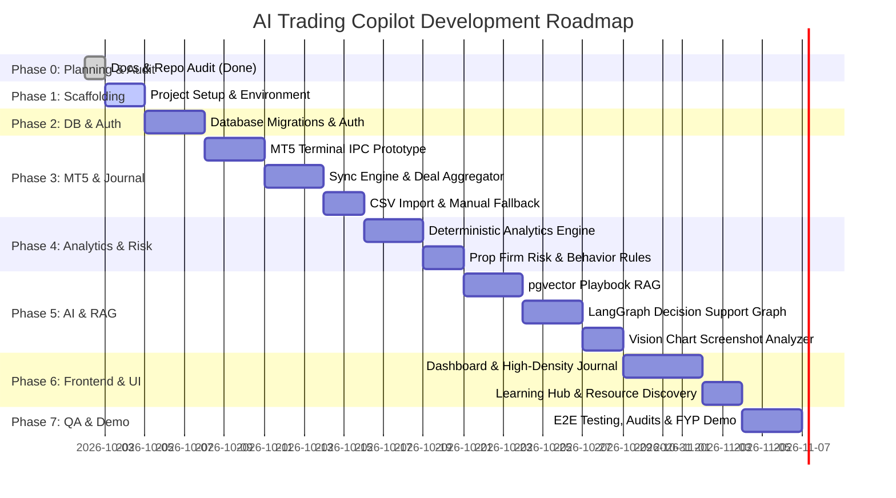

# Implementation Tasks & Development Roadmap

## Project Title
**AI Trading Copilot — Intelligent Trading Analytics, Risk Management & Decision Support System**

---

## 1. Roadmap Overview & Milestones

The roadmap is structured into sequential, dependency-aware phases. Each task is defined with a unique ID, MoSCoW priority, explicit dependencies, acceptance criteria, test requirements, and status.

---

## 2. Granular Task Breakdown

### Phase 0: Repository Audit & Planning (Complete)
- [x] **TASK-000: Initial Repository Audit & Documentation System**
  - **Priority:** Must Have (MVP)
  - **Dependencies:** None
  - **Output:** `PRD.md`, `ARCHITECTURE.md`, `RULES.md`, `DESIGN.md`, `TASKS.md`, `MEMORY.md`.
  - **Acceptance Criteria:** All six core documents created in root, audited environment (Windows 11, MT5 terminal located at `C:\Program Files\MetaTrader 5\terminal64.exe`, Node 22, Python 3.12).
  - **Status:** **DONE**

---

### Phase 1: Foundation & Project Scaffolding
- [x] **TASK-001: Backend Service Scaffolding (FastAPI)**
  - **Priority:** Must Have (MVP)
  - **Dependencies:** TASK-000
  - **Output:** `backend/` directory structure with FastAPI, requirements.txt, pyproject.toml, CORS, configuration settings via `pydantic-settings`, structured logging with secret masking, typed error handling, SQLAlchemy 2.0 async session factory & base models, and health check endpoint `/api/v1/health`.
  - **Acceptance Criteria:** Running ASGI app responds with `{"status": "healthy", "service": "ai-trading-copilot-backend"}` on port 8000; detects MT5 terminal and database connection.
  - **Tests:** `pytest backend/tests` passes 4/4 tests (`test_health.py`, `test_errors.py`). Ruff lint/format clean.
  - **Effort:** 3 hours
  - **Status:** **DONE**

- [x] **TASK-002: Frontend Workspace Scaffolding (Next.js 14+ App Router)**
  - **Priority:** Must Have (MVP)
  - **Dependencies:** TASK-000
  - **Output:** `frontend/` directory with Next.js 14+ App Router, TypeScript, Tailwind CSS, FinTech design tokens according to `DESIGN.md`, `cn` utility, `Badge` with mandatory data classification variants, responsive `Sidebar` and `Header` shells, and executive dashboard layout connected to backend health diagnostics.
  - **Acceptance Criteria:** `npm run build` and `npm run lint` succeed with zero errors; clean high-density dark mode obsidian slate aesthetic with Recharts equity curve and behavior guard indicators.
  - **Tests:** `npm run lint` passes (0 errors/warnings); `npm run build` generates optimized production bundle.
  - **Effort:** 3 hours
  - **Status:** **DONE**

---

### Phase 2: Database Layer & Authentication
- [x] **TASK-003: PostgreSQL & pgvector Schema Setup with Alembic**
  - **Priority:** Must Have (MVP)
  - **Dependencies:** TASK-001
  - **Output:** SQLAlchemy 2.0 models for `User`, `TradingAccount`, `RawMT5Deal`, `JournalEntry`, `DealJournalMapping`, `Strategy`, `UserRule`, `DocumentKnowledge`, `DocumentChunk`. Async Alembic configuration and initial migration `d02be136d042_initial_schema_setup.py`. Diagnostic verification script `backend/scripts/verify_supabase.py`.
  - **Acceptance Criteria:** `alembic upgrade head` executed against live Supabase PostgreSQL 17 database without errors. All 9 relational and vector tables, 12 foreign keys, 31 indexes, and `vector(1536)` columns verified in live database at revision `d02be136d042`.
  - **Tests:** Live database inspection ([verify_tables.py](file:///d:/Saylani%20Final%20Project/AI%20Trading%20Copilet/Saylani-final-capiston/backend/scripts/verify_tables.py)) and diagnostic suite ([verify_supabase.py](file:///d:/Saylani%20Final%20Project/AI%20Trading%20Copilet/Saylani-final-capiston/backend/scripts/verify_supabase.py)). Pytest passes 7/7 tests. Ruff clean.
  - **Effort:** 5 hours
  - **Status:** **DONE**

- [x] **TASK-004: JWT Authentication & User Isolation Middleware**
  - **Priority:** Must Have (MVP)
  - **Dependencies:** TASK-003
  - **Output:** Endpoints for `/api/v1/auth/register`, `/api/v1/auth/login`, and `/api/v1/auth/me`. Bcrypt password hashing (`backend/app/core/security.py`) and RFC 7519 JWT generator with HS256. Dependency `get_current_user` and ownership validator `enforce_resource_ownership` (`backend/app/api/deps.py`). Pydantic v2 schemas (`backend/app/schemas/auth.py`). Rollback-safe live DB verification script (`backend/scripts/verify_auth_rollback.py`).
  - **Acceptance Criteria:** Protected endpoints reject missing/expired tokens with 401; user can only retrieve their own record; multi-tenant cross-user access attempts raise 403 Forbidden.
  - **Tests:** `tests/test_auth.py` covering registration, duplicate email rejection (409), login, bad password, non-existent user, token expiry, tampered tokens, missing tokens, and multi-tenant isolation (12 tests). Live database rollback verification verified zero residual data. Pytest suite: 19/19 passed. Ruff clean.
  - **Effort:** 4 hours
  - **Status:** **DONE**

---

### Phase 3: Trading Account Management & MT5 Integration Prototype
- [x] **TASK-005: MT5 Windows Terminal IPC Proof-of-Concept (POC)**
  - **Priority:** Must Have (MVP)
  - **Dependencies:** TASK-001
  - **Output:** Read-only service `backend/app/services/mt5_connector.py` (with import shim `backend/services/mt5_connector.py`), typed Pydantic models `backend/app/schemas/mt5.py`, and standalone CLI tool `backend/scripts/test_mt5_connection.py`.
  - **Acceptance Criteria:** Official `MetaTrader5` 5.0.6231 cp312 package integrated. Law of Read-Only Safety enforced (`order_send`, `order_check`, `position_close` raise `PermissionError`). Context manager with guaranteed `shutdown()`. Typed schemas for terminal status, account info (with login masking), historical deals, and open positions.
  - **Tests:** `tests/test_mt5_connector.py` covering 14 mock unit tests (init success/failure, missing binary, terminal status, account info and masking, unauthorized handling, historical deal range query, empty vs fatal error handling, invalid date bounds, open positions, guaranteed shutdown, read-only safety guardrails, diagnostics). Full backend pytest suite: 33/33 passed. Ruff lint & format: 100% clean. Live terminal IPC verified against host executable `C:\Program Files\MetaTrader 5\terminal64.exe` (119MB) with graceful handling of unauthenticated terminal session (`-6, Terminal: Authorization failed`).
  - **Effort:** 5 hours
  - **Status:** **DONE**

- [x] **TASK-006: Trading Account CRUD & Credential Encryption**
  - **Priority:** Must Have (MVP)
  - **Dependencies:** TASK-004, TASK-005
  - **Output:** Endpoints for creating (`POST /api/v1/accounts`), listing (`GET /api/v1/accounts`), retrieving (`GET /api/v1/accounts/{id}`), updating (`PUT /api/v1/accounts/{id}`), and safe deleting (`DELETE /api/v1/accounts/{id}`) trading accounts. AES-256-GCM authenticated encryption for investor credentials with cryptographically secure 12-byte nonce.
  - **Acceptance Criteria:** Account created with initial balance and type (Live, Demo, Prop); passwords never exposed in plaintext or API responses; tenant isolation enforced; safe deletion retention blocks deletion of accounts with historical trades unless `force=true`.
  - **Tests:** `tests/test_accounts.py` covering 13 unit/integration tests (roundtrip encryption, unique nonces, wrong key rejection, tampered ciphertext rejection, malformed payload, key validation, production key guard, create account & password redaction, duplicate account conflict, validation errors, multi-tenant read isolation, update isolation, safe deletion retention policy). Live database rollback verification via `backend/scripts/verify_accounts_rollback.py` verified 0 residual records. Full pytest suite: 46/46 passed. Ruff clean.
  - **Effort:** 4 hours
  - **Status:** **DONE**

- [x] **TASK-007: Automated Deal Aggregator & Idempotent Sync Worker**
  - **Priority:** Must Have (MVP)
  - **Dependencies:** TASK-005, TASK-006
  - **Output:** Background synchronization engine `backend/app/services/sync_worker.py` (with compatibility shim at `backend/services/sync_worker.py`). Implements deal-ticket deduplication, position grouping (handling multiple entry fills, partial closes, and scaling), volume-weighted entry/exit calculation, net P&L financial math (commission, swap, fee), and idempotent upserting into `journal_entries` and `deal_journal_mappings`.
  - **Acceptance Criteria:** Ingesting multi-deal positions with partial closes groups them into correct positions without duplicate records on repeated syncs. User-authored notes are strictly preserved.
  - **Tests:** `tests/test_mt5_sync.py` with 9 passing tests; verified with live transactional rollback against Supabase PostgreSQL.
  - **Effort:** 8 hours
  - **Status:** `DONE`

- [x] **TASK-008: CSV Trade History Import & Manual Entry Fallback**
  - **Priority:** Must Have (MVP)
  - **Dependencies:** TASK-006
  - **Output:** CSV parser supporting standard MT5 exported HTML/CSV trade reports and canonical CSV imports (`backend/app/services/csv_importer.py`, with import shim `backend/services/csv_importer.py`), typed Pydantic schemas (`backend/app/schemas/journal.py`), dry-run preview endpoint (`POST /api/v1/journal/csv/preview`), transactional import endpoint (`POST /api/v1/journal/csv/import` and `/api/v1/accounts/{id}/journal/csv`), manual trade CRUD endpoints (`POST`, `GET`, `PUT`, `DELETE` on `/api/v1/journal/entries`), and live Supabase PostgreSQL transactional verification script (`backend/scripts/verify_csv_and_manual_rollback.py`).
  - **Acceptance Criteria:** Users without an active MT5 terminal can upload canonical or standard MT5 CSV trade reports or enter manual trades, populating the journal identically to auto-synced trades. Idempotency guarantees: repeated CSV imports create 0 duplicate journal entries using `csv:<hex[:60]>` hash. Formula injection sanitized (`=, +, -, @`). Realized P&L and R:R ratios computed deterministically in Python (zero LLM math). Multi-tenant isolation strictly enforced. Market execution fields on MT5-synced trades are protected against tampering.
  - **Tests:** `tests/test_csv_and_manual_journal.py` covering 13 unit/integration tests (open manual trade, closed manual trade with deterministic math, manual trade validation errors, manual trade multi-tenant isolation, update manual trade preserves notes & recalculates, update MT5-synced trade blocks altering market data, CSV preview valid file, CSV preview row errors, CSV import canonical & journal query, CSV import MT5 format with duplicate headers, CSV import strict idempotency on repeated runs, formula injection sanitization, CSV import cross-user isolation). Live Supabase transactional rollback script verified 0 residual records. Full test suite: 68/68 passed. Ruff lint & format: 100% clean.
  - **Effort:** 4 hours
  - **Status:** **DONE**

---

### Phase 4: Deterministic Analytics & Risk Engines
- [x] **TASK-009: Deterministic Financial Analytics Engine**
  - **Priority:** Must Have (MVP)
  - **Dependencies:** TASK-007, TASK-008
  - **Output:** Deterministic analytics engine `backend/app/analytics/engine.py` (with compatibility shim `backend/analytics/engine.py`), typed Pydantic schemas `backend/app/schemas/analytics.py`, authenticated REST endpoints in `backend/app/api/v1/endpoints/analytics.py` (`GET /api/v1/analytics/summary`, `GET /api/v1/analytics/equity-curve`, `GET /api/v1/analytics/breakdowns`, plus account-scoped shortcuts `/api/v1/accounts/{id}/analytics/...`), and live Supabase PostgreSQL transactional verification script `backend/scripts/verify_analytics_rollback.py`.
  - **Acceptance Criteria:** Zero LLM involvement. Zero-division and zero-variance handled safely (`gross_losses == 0` -> `profit_factor = None`, zero downside risk -> `sortino = None`, zero variance -> `sharpe = None`). Net P&L accounts for gross profit, commissions, swaps, and fees. Open and partial trades are strictly segregated from closed metrics. Chronological equity curve tracks high-water mark and monetary vs percentage drawdown. Sharpe and Sortino ratios carry explicitly documented assumptions (unannualized per-trade returns). Currency isolation strictly enforced (rejects aggregating mixed currencies without account/currency filter).
  - **Tests:** `tests/test_analytics.py` covering 11 unit and integration tests (independent benchmark hand-calculated dataset, empty dataset safe zeroes, all-winning trades zero loss guard, all-losing trades, zero variance Sharpe guard, exclusion of open/partial trades, multidimensional breakdowns, summary & equity curve API, multi-tenant isolation, date bounds validation, mixed currency rejection). Live Supabase transactional rollback verified with 0 residual records. Full test suite: 79/79 passed in 36.81s. Ruff lint & format: 100% clean.
  - **Effort:** 6 hours
  - **Status:** **DONE**

- [x] **TASK-010: Prop Firm Risk Manager Engine**
  - **Priority:** Must Have (MVP)
  - **Dependencies:** TASK-009
  - **Output:** Deterministic prop firm risk engine `backend/app/analytics/risk_engine.py` (with compatibility shim `backend/analytics/risk_engine.py`), typed Pydantic v2 schemas `backend/app/schemas/risk.py`, authenticated REST endpoints in `backend/app/api/v1/endpoints/risk.py` (profile CRUD, account risk evaluation with optional manual snapshot override, template listing), and live Supabase PostgreSQL transactional verification script `backend/scripts/verify_risk_rollback.py`.
  - **Acceptance Criteria:** Computes real-time daily drawdown, static maximum drawdown, and trailing drawdown with high-water mark tracking and initial balance locking. Triggers accurate visual risk gauge levels: GREEN (<50%), AMBER (50-80%), RED (>80%), and BREACHED (>=100%). Handles timezone and DST-aware session resets via Python `zoneinfo` and `tzdata`. Supports BALANCE_BASED and EQUITY_BASED daily loss calculation. Zero LLM math. Strict multi-tenant isolation enforced.
  - **Tests:** `tests/test_risk_engine.py` covering 9 unit and integration tests (daily reset window calculation with timezones, balance vs equity daily loss, exact threshold boundary values 49.9%/50%/79.9%/80%/100%, trailing drawdown HWM and initial balance lock, missing data UNAVAILABLE state, profit target progress, full profile CRUD lifecycle, account risk evaluation with snapshot override, multi-tenant boundary). Live Supabase transactional rollback script verified 0 residual records. Full test suite: 88/88 passed in 39.49s. Ruff lint & format: 100% clean.
  - **Effort:** 4 hours
  - **Status:** **DONE**

- [x] **TASK-011: Trading Behavior Analyzer**
  - **Priority:** Must Have (MVP)
  - **Dependencies:** TASK-009
  - **Output:** Deterministic trading behavior engine `backend/app/analytics/behavior_analyzer.py` (with compatibility shim at `backend/analytics/behavior_analyzer.py`), typed Pydantic v2 schemas `backend/app/schemas/behavior.py`, authenticated REST endpoints in `backend/app/api/v1/endpoints/behavior.py` (`GET /api/v1/behavior/summary`, `GET /api/v1/behavior/findings`, `POST /api/v1/behavior/analyze`, `GET /api/v1/accounts/{id}/behavior/...`, `GET/PUT /api/v1/behavior/config`), and live Supabase PostgreSQL transactional verification script `backend/scripts/verify_behavior_rollback.py`.
  - **Acceptance Criteria:** Outputs neutral, objective statistical behavioral flags without psychoanalyzing or diagnosing the trader:
    - **Rapid Re-entry After Loss ("Revenge Trading"):** Flags trades opened within configurable window (default 15 mins) after a loss. Computes exact time gap, volume escalation, and segregates overlapping/concurrent positions.
    - **Overtrading Frequency:** Detects unusually high trading frequency by session and day using completed and open positions. Distinguishes user-configured thresholds from trader's historical inferred baseline (mean + 1.5 std, floor 5) without universal threshold hallucination.
    - **Risk Escalation (Martingale-like sizing):** Identifies lot size increases following losses. Standardized to same-symbol comparison to prevent cross-instrument contract distortions; labeled as statistical sizing pattern.
    - **Session Drift:** Evaluates trade entry times against user-configured allowed sessions or local hours with IANA timezones and DST support. Returns insufficient configuration when unconfigured without inventing preferred trading hours.
    - **Discipline Score:** Deterministic score (0-100) based on finding frequency and severity.
    - **Strict Tenancy & Zero LLM Math:** Scoped to authenticated `user_id` with 100% deterministic Python mathematics.
  - **Tests:** `tests/test_behavior_analyzer.py` covering 14 unit and integration tests (rapid re-entry detection and win/concurrent trade guards, user-configured and baseline-inferred overtrading, insufficient history safeguards, same-symbol risk escalation and contract normalization, session drift with allowed sessions and timezone windows, discipline score calculation, empty dataset handling, behavior summary and findings API endpoints, user config CRUD, multi-tenant isolation). Live Supabase transactional rollback script verified 0 residual records. Full test suite: 102/102 passed in 43.24s. Ruff lint & format: 100% clean across all 78 backend files.
  - **Effort:** 4 hours
  - **Status:** **DONE**

---

### Phase 5: AI Orchestration, RAG & Decision Support
- [x] **TASK-012: Personal Playbook Knowledge Base (pgvector RAG)**
  - **Priority:** Must Have (MVP)
  - **Dependencies:** TASK-003, TASK-004
  - **Output:** Secure multi-tenant Personal Playbook Knowledge Base supporting:
    - Alembic migration `a1b2c3d4e5f6` adding `status`, `chunk_count`, and `error_message` to `document_knowledge` table.
    - Pure-Python PDF parser (`pypdf>=4.2.0`), Markdown, and plain text extraction with page tracking, size limits (10MB), and path-traversal sanitization in `backend/app/services/document_parser.py`.
    - Semantic chunker with paragraph and sentence boundary preservation, configurable size (default 800 chars), overlap (default 100 chars), and max chunk safety limit (500 chunks).
    - 1536-dimensional embedding provider service (`backend/app/services/embedding_service.py`) compatible with `Vector(1536)` schema, supporting OpenAI REST API (`text-embedding-3-small`) and deterministic offline token-based semantic mock embeddings for dev/testing.
    - RAG retrieval engine (`backend/app/services/rag_engine.py`) using native pgvector cosine distance `<=>` search on PostgreSQL and NumPy fallback for SQLite tests, strictly enforcing `WHERE user_id = :current_user_id`.
    - Evidence-grounded Q&A synthesizer with exact source citations (filename, page, chunk), confidence scoring, uncertainty limitations, and anti-prompt-injection isolation delimiters that treat uploaded text as untrusted data and neutralize malicious instructions or profit guarantee attempts.
    - Authenticated REST API endpoints in `backend/app/api/v1/endpoints/playbook.py` (`POST /api/v1/playbook/documents`, `GET /api/v1/playbook/documents`, `GET /api/v1/playbook/documents/{id}`, `DELETE /api/v1/playbook/documents/{id}`, `POST /api/v1/playbook/documents/{id}/reprocess`, `POST /api/v1/playbook/search`, `POST /api/v1/playbook/ask`).
    - Live Supabase PostgreSQL transactional rollback verification script (`backend/scripts/verify_playbook_rollback.py`).
  - **Acceptance Criteria:** Users can upload trading playbooks, strategies, checklists, rules, and notes; vector similarity search returns relevant chunks filtered strictly by user ownership in the SQL query itself; zero cross-tenant leakage; citations accurately pinpoint source documents and pages; questions with insufficient evidence clearly state lack of context rather than hallucinating answers; zero LLM arithmetic; no API keys exposed in errors, logs, or responses.
  - **Tests:** `tests/test_playbook_rag.py` covering 13 unit and integration tests (path traversal sanitization, text extraction for .txt/.md/.pdf, upload validation errors, chunk boundary splitting and metadata, max chunk limit, mock embedding 1536-dim unit norm, embedding provider factory, pgvector semantic search with similarity threshold, grounded Q&A with citations and limitations, prompt injection guardrail neutralization, full REST API lifecycle, and multi-tenant isolation across User A and User B). Live Supabase transactional rollback script verified with 0 residual records. Full test suite: 115/115 passed in 43.59s. Ruff check & format: 100% clean across all 87 backend files.
  - **Effort:** 6 hours
  - **Status:** **DONE**

- [x] **TASK-013: LangGraph AI Trade Reviewer (Pre & Post-Trade)**
  - **Priority:** Must Have (MVP)
  - **Dependencies:** TASK-010, TASK-011, TASK-012
  - **Output:** LangGraph state machine orchestrating typed inspectable DAG: `Input Validation -> Context Loading -> Risk Evaluation -> Playbook Retrieval (pgvector RAG) -> Behavioral Analysis -> Evidence Validation -> Structured Synthesis -> Badge Assignment -> Response Finalization`.
  - **Acceptance Criteria:** Outputs structured JSON review adhering to Pydantic v2 schemas (`TradeReviewResponse`, `PreTradeReviewRequest`, `PostTradeReviewRequest`) with strict deterministic risk limits, no pip/contract size fabrication without broker specs, zero LLM arithmetic, multi-tenant isolation, prompt injection containment, and deterministic badge precedence (`RISK_LIMIT_BREACHED`, `RISK_WARNING`, `MISSING_STOP_LOSS`, `PLAYBOOK_CONFLICT`, `PLAYBOOK_MATCH`, `BEHAVIORAL_PATTERN_DETECTED`, `RISK_WITHIN_CONFIGURED_LIMITS`, `INSUFFICIENT_EVIDENCE`, `REVIEW_INCOMPLETE`).
  - **Tests:** `tests/test_trade_reviewer.py` covering 9 comprehensive unit and integration tests (valid pre-trade with playbook match, missing stop loss trigger, inverted price geometry validation, playbook rule conflict detection, rapid re-entry behavioral detection, post-trade closed trade audit, REST API lifecycle with persistence, cross-tenant isolation, and prompt injection safety). Live Supabase transactional rollback script (`backend/scripts/verify_reviewer_rollback.py`) verified with 0 residual records. Full test suite: 124/124 passed in 47.65s. Ruff check & format: 100% clean across all 94 backend files.
  - **Effort:** 8 hours
  - **Status:** **DONE**

- [x] **TASK-014: AI Chart Screenshot Analyzer (Vision)**
  - **Priority:** Should Have
  - **Dependencies:** TASK-013
  - **Output:** Authenticated vision endpoints and dedicated frontend UI accepting chart screenshots (PNG, JPEG, WEBP) with secure image validation, decompression bomb defense, format re-encoding, and prompt-injection neutralization. Executes structured technical analysis across configurable frameworks (`ICT`, `SMC`, `PRICE_ACTION`, `GENERAL`), extracting market structure, key levels, trade setups, and comparative bullish/bearish scenarios with explicit invalidation conditions. Integrates with TASK-012 for personal playbook RAG cross-referencing and provides seamless handoff to TASK-013 Pre-Trade Reviewer.
  - **Acceptance Criteria:** Outputs structured JSON review adhering to Pydantic v2 schemas (`ChartAnalysisResponse`, etc.) with mandatory visual distinction badges (`[AI INTERPRETATION]`, `[OBSERVED PATTERN]`, `[UNVERIFIED LEVELS]`, `[PLAYBOOK ALIGNED]`, `[PLAYBOOK CONFLICT]`, `[INSUFFICIENT IMAGE EVIDENCE]`, `[PROMPT INJECTION FLAGGED]`). Zero fabricated monetary values or pip counts without verified broker specs; strict multi-tenant isolation; clean transactional teardown.
  - **Tests:** `tests/test_vision_analyzer.py` covering 15 unit and integration tests (valid PNG/JPEG/WEBP formats, empty bytes, unsupported extensions, corrupted content, dimensions too small/large, ICT/SMC/Price Action modes, unreadable blurry image fallback with `INSUFFICIENT_IMAGE_EVIDENCE`, prompt injection neutralization, personal playbook RAG alignment and citations, pre-trade reviewer handoff, REST API lifecycle, and cross-tenant isolation). Live Supabase transactional rollback script (`backend/scripts/verify_vision_rollback.py`) verified with 0 residual records. Full test suite: 139/139 passed. Ruff check & format: 100% clean across all 103 backend files.
  - **Effort:** 5 hours
  - **Status:** **DONE**

- [x] **TASK-015: Beginner Learning Hub & Curated Resource Discovery**
  - **Priority:** Should Have
  - **Dependencies:** TASK-001
  - **Output:** Structured curriculum content across 6 tracks (Forex Fundamentals, Risk Management, Technical Analysis, Smart Money Concepts [SMC], Inner Circle Trader [ICT], and Trading Psychology & Behavioral Discipline) with 14 in-depth lessons. Curated catalog of 14 vetted educational resources with multi-attribute filtering (topic, difficulty, cost, format, search) and pagination. REST endpoints under `/api/v1/learning/` and responsive Next.js frontend pages (`/learning` and `/resources`).
  - **Acceptance Criteria:** Neutral presentation with zero "guaranteed profit" or "best trader" bias. Strict distinction between empirical market mechanics and discretionary frameworks. Deterministic mathematical accuracy in hypothetical position sizing examples. No referral links, no fabricated prices or claims.
  - **Tests:** `tests/test_learning_hub.py` covering 14 unit and integration tests (curriculum categories, lesson filtering, lesson detail by ID and slug, 404 handling, curated resources multi-attribute filtering, pagination, query validation with 422, resource detail by ID, JWT authentication enforcement, URL validity and publisher hygiene, empty catalog handling, and deterministic risk math). Full backend test suite: 153/153 passed in 60.72s. Ruff check & format: 100% clean across all 109 backend files.
  - **Effort:** 4 hours
  - **Status:** **DONE**

---

### Phase 6: Frontend UI/UX Implementation
- [x] **TASK-016: Design System Setup & Layout Shell**
  - **Priority:** Must Have (MVP)
  - **Dependencies:** TASK-002
  - **Output:** Consolidated Tailwind CSS v3 dark obsidian design tokens, responsive layout shell (`AppShell`), persistent desktop sidebar with responsive slide-over mobile drawer and overlay backdrop, refined institutional header with preserved evidence-based `boolean | null` status indicator model, and reusable design system primitives (`Button`, `Card`, `Input`, `StatCard`, `EmptyState`, `ErrorBanner`, `Badge`).
  - **Acceptance Criteria:** Responsive layout with smooth desktop navigation, mobile drawer transitions, zero layout shift, clear financial state visual indicators without relying on color alone, strict preservation of MT5 file detection vs. session authentication semantics, and unified integration across existing routes (`/`, `/learning`, `/resources`, `/resource`, `/vision`).
  - **Tests:** Next.js production build (`npm.cmd run build`) completed with 0 errors across all 9 static pages; ESLint check (`npm.cmd run lint`) 100% clean with 0 warnings and 0 errors; full backend regression suite (29/29 passed in 11.95s).
  - **Effort:** 4 hours
  - **Status:** **DONE**

- [x] **TASK-017: MT5 Connection Wizard & Account Management UI**
  - **Priority:** Must Have (MVP)
  - **Dependencies:** TASK-006, TASK-016
  - **Output:** Dedicated `/accounts` management workspace with persistent account selection, account registration modal (`CreateAccountModal`) with AES-256-GCM read-only investor password advisory, multi-account cards (`AccountCard`) with live balance/equity figures and safe data retention deletion policy, MT5 connection wizard (`MT5ConnectionWizard`) with step-by-step terminal prerequisites and on-demand deal sync trigger, CSV trade history importer (`CSVImporter`) with client-side validation, drag-and-drop, dry-run preview verification, and idempotent transactional commit, and manual trade entry form (`ManualTradeEntry`) with dynamic R:R geometry calculation, automatic session tagging, and deterministic Net P&L aggregation.
  - **Acceptance Criteria:** Strict separation of host terminal binary detection vs. authenticated active broker session; real-time synchronization progress metrics; honest error diagnostics with resilient offline fallback guidance (CSV & manual journaling); zero credential or plaintext password exposure; active account context synced across header and navigation.
  - **Tests:** Production build (`npm.cmd run build`) completed with 0 errors across all 10 static routes; ESLint check (`npm.cmd run lint`) 100% clean with 0 warnings and 0 errors; full backend regression suite for accounts, MT5 connector, sync worker, and CSV/manual journal (49/49 passed in 31.87s).
  - **Effort:** 5 hours
  - **Status:** **DONE**

- [x] **TASK-018: High-Density Trading Journal & Trade Detail Drawer**
  - **Priority:** Must Have (MVP)
  - **Dependencies:** TASK-007, TASK-016
  - **Output:** Institutional `/journal` workspace featuring top KPI metrics (`StatCard` for Realized Net P&L, Win Rate %, Profit Factor, Recorded Trades), multi-attribute filter bar (search symbol, account dropdown, direction pills, status/outcome buttons, source selector, start/end dates, clear filters), high-density responsive trade table (`TradeTable`) with sticky headers, sortable columns, explicit `+`/`-` signed values, outcome badges, source badges (`MT5`, `CSV`, `MANUAL`), and bounded pagination controls (25, 50, 100/page), comprehensive slide-over drawer (`TradeDetailDrawer`) displaying trade geometry, financial accounting breakdown (Gross Profit + Commission + Swap = Net P&L), risk protection parameters, inline discretionary notes/setup editor, truthful AI retrospective audits with playbook rule citations and behavioral flags, and two-step safe deletion modal. Backend enhancement in `backend/app/api/v1/endpoints/reviewer.py` adding `journal_entry_id` filter to `GET /api/v1/reviewer/reviews`.
  - **Acceptance Criteria:** Renders trades smoothly with instant filtering, sorting, and drawer inspection. Explicit signed values avoid color-alone reliance. Truthful "No retrospective available" state when no review exists (zero fabricated AI analysis or unrequested LLM triggers). Supports closing drawer via close button and Escape key. Multi-tenant isolation verified across backend endpoints.
  - **Tests:** Next.js production build (`npm.cmd run build`) completed with 0 errors across 11 static pages; ESLint check (`npm.cmd run lint`) 100% clean with 0 warnings and 0 errors; full backend regression suite for journal, CSV importer, manual trades, and AI trade reviewer (`pytest backend/tests/test_csv_and_manual_journal.py backend/tests/test_trade_reviewer.py` — 23/23 passed in 18.55s).
  - **Effort:** 6 hours
  - **Status:** **DONE**

- [x] **TASK-019: Executive Dashboard, Equity Curve & Risk Gauges UI**
  - **Priority:** Must Have (MVP)
  - **Dependencies:** TASK-009, TASK-010, TASK-016
  - **Output:** Fully functional executive dashboard (`frontend/src/app/page.tsx`) eliminating all hardcoded/synthetic demo data. Authenticated account-scoped metrics powered by `GET /api/v1/analytics/summary` (`PerformanceMetrics`: Realized Net P&L, Win Rate %, Profit Factor, Max Drawdown), chronological equity curve chart (`EquityCurveChart`) powered by `GET /api/v1/analytics/equity-curve` with view toggles (Closed Equity, Cumulative Net P&L, Drawdown %) and summary statistics, real-time prop firm risk gauges (`RiskGauges`) powered by `GET /api/v1/risk/accounts/{id}/risk` with daily loss allowance usage, trailing drawdown boundaries, profit targets, and warning advisories. Includes account selector, system health probe, responsive empty states with direct shortcuts to MT5 sync, CSV import, and manual trade entry, and quick links to `/journal`, `/accounts`, and `/vision`.
  - **Acceptance Criteria:** Dynamic update on account switch; no hallucinated demo numbers on real accounts; zero division-by-zero errors on empty datasets; explicit signed notation avoids color-alone reliance; distinction between physical MT5 binary presence vs. authenticated broker connection preserved.
  - **Tests:** Next.js production build (`npm.cmd run build`) completed with 0 errors across 11 static pages; ESLint check (`npm.cmd run lint`) 100% clean with 0 warnings and 0 errors; full backend analytics and risk test suites (`pytest backend/tests/test_analytics.py backend/tests/test_risk_engine.py` — 20/20 passed in 8.04s).
  - **Effort:** 6 hours
  - **Status:** **DONE**

- [x] **TASK-020: AI Trade Reviewer & Screenshot Analyzer UI**
  - **Priority:** Must Have (MVP)
  - **Dependencies:** TASK-013, TASK-014, TASK-016
  - **Output:** Dedicated `/review` Pre-Trade Reviewer workspace featuring an institutional order setup checklist form (Account selector, Symbol with uppercase normalization, Direction toggle [BUY/SELL], Planned Lot Size, Entry Price, Stop Loss with missing-SL warning badge, Take Profit, Playbook Strategy Tag, and Trader Setup Reasoning Notes) with real-time client-side geometry and planned R:R preview; full LangGraph review results container displaying deterministic risk & geometry validation (Risk Status level, Planned R:R, Daily Loss Buffer, Daily Drawdown %), color-coded taxonomy badges (`RISK_LIMIT_BREACHED`, `MISSING_STOP_LOSS`, `PLAYBOOK_MATCH`, `PLAYBOOK_CONFLICT`, `BEHAVIORAL_PATTERN_DETECTED`, `RISK_WITHIN_CONFIGURED_LIMITS`), personal playbook rule compliance findings with document/page citations and match strength, historical behavioral pattern alerts (rapid re-entry after loss discipline guard), synthesized executive review summary with clear deterministic calculation disclosures, and uncertainty score with limitations list. Centralized API client integration in `frontend/src/lib/api.ts` adding typed interfaces (`RiskAssessmentResult`, `PlaybookEvidenceItem`, `BehaviorContextItem`, `TradeReviewResponse`, `PreTradeReviewPayload`, `ChartAnalysisResponse`) and callers (`runPreTradeReview`, `analyzeChartScreenshot`). Fixed `/vision` production integration by removing hardcoded localhost URL in favor of `analyzeChartScreenshot`, with safe URL-encoded parameters for the "Audit with Pre-Trade Reviewer" handoff. Enabled `/review` in `frontend/src/components/layout/sidebar.tsx` with active indicator dot.
  - **Acceptance Criteria:** Responsive layout with smooth handoff from `/vision` to `/review`; pre-population of detected symbol and side; real-time client-side geometry error detection (preventing inverted BUY/SELL stop-loss/take-profit geometry); missing stop-loss warning callouts; authoritative server-side review execution via LangGraph; clear separation between deterministic calculations vs AI interpretations; zero unauthenticated or hardcoded URL calls; 100% type safety without `@ts-ignore` or `any`.
  - **Tests:** Next.js production build (`npm.cmd run build`) completed with 0 errors across all 12 static routes; ESLint check (`npm.cmd run lint`) 100% clean with 0 warnings and 0 errors; full backend regression suite for AI trade reviewer and vision analyzer (`pytest tests/test_trade_reviewer.py tests/test_vision_analyzer.py` — 25/25 passed in 9.50s).
  - **Effort:** 5 hours
  - **Status:** **DONE**

- [ ] **TASK-021: Learning Hub & Resource Discovery UI**
  - **Priority:** Should Have
  - **Dependencies:** TASK-015, TASK-016
  - **Output:** Interactive curriculum viewer and searchable/filterable educational resource directory.
  - **Acceptance Criteria:** Accessible card grid and markdown lesson viewer.
  - **Tests:** Navigation and filter tests.
  - **Effort:** 4 hours
  - **Status:** `TODO`

---

### Phase 7: QA, Security Verification & Final Presentation
- [ ] **TASK-022: End-to-End System Testing & Security Audit**
  - **Priority:** Must Have (MVP)
  - **Dependencies:** TASK-017 through TASK-021
  - **Output:** Playwright E2E test suite covering: Registration -> MT5/CSV Connection -> Journal Ingestion -> Analytics Calculation -> Pre-Trade Review. Security verification for credential encryption and tenant isolation.
  - **Acceptance Criteria:** 100% pass on core user journeys; zero security leaks in logs.
  - **Tests:** Playwright E2E test runs.
  - **Effort:** 8 hours
  - **Status:** `TODO`

- [ ] **TASK-023: Final Year Project (FYP) Demo Mode & Documentation Packaging**
  - **Priority:** Must Have (MVP)
  - **Dependencies:** TASK-022
  - **Output:** Seed script for high-fidelity demonstration accounts (with explicit `[DEMO DATA]` badges), presentation walkthrough guide, and deployment runbook.
  - **Acceptance Criteria:** Flawless live demonstration flow for academic defense and evaluation.
  - **Tests:** Clean local startup verification on Windows host.
  - **Effort:** 4 hours
  - **Status:** `TODO`
