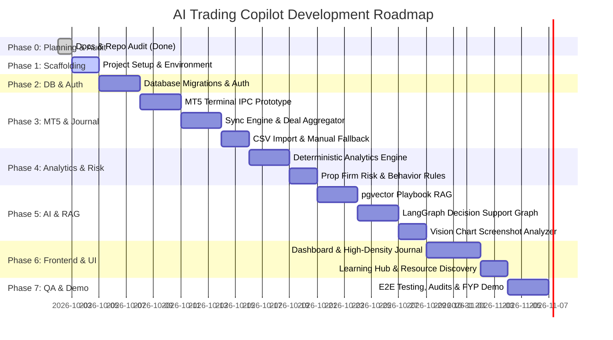

# Implementation Tasks & Development Roadmap

## Project Title
**AI Trading Copilot — Intelligent Trading Analytics, Risk Management & Decision Support System**

---

## 1. Roadmap Overview & Milestones

The roadmap is structured into sequential, dependency-aware phases. Each task is defined with a unique ID, MoSCoW priority, explicit dependencies, acceptance criteria, test requirements, and status.

---

## 2. Granular Task Breakdown

### Phase 0: Repository Audit & Planning (Complete)
- [x] **TASK-000: Initial Repository Audit & Documentation System**
  - **Priority:** Must Have (MVP)
  - **Dependencies:** None
  - **Output:** `PRD.md`, `ARCHITECTURE.md`, `RULES.md`, `DESIGN.md`, `TASKS.md`, `MEMORY.md`.
  - **Acceptance Criteria:** All six core documents created in root, audited environment (Windows 11, MT5 terminal located at `C:\Program Files\MetaTrader 5\terminal64.exe`, Node 22, Python 3.12).
  - **Status:** **DONE**

---

### Phase 1: Foundation & Project Scaffolding
- [x] **TASK-001: Backend Service Scaffolding (FastAPI)**
  - **Priority:** Must Have (MVP)
  - **Dependencies:** TASK-000
  - **Output:** `backend/` directory structure with FastAPI, requirements.txt, pyproject.toml, CORS, configuration settings via `pydantic-settings`, structured logging with secret masking, typed error handling, SQLAlchemy 2.0 async session factory & base models, and health check endpoint `/api/v1/health`.
  - **Acceptance Criteria:** Running ASGI app responds with `{"status": "healthy", "service": "ai-trading-copilot-backend"}` on port 8000; detects MT5 terminal and database connection.
  - **Tests:** `pytest backend/tests` passes 4/4 tests (`test_health.py`, `test_errors.py`). Ruff lint/format clean.
  - **Effort:** 3 hours
  - **Status:** **DONE**

- [x] **TASK-002: Frontend Workspace Scaffolding (Next.js 14+ App Router)**
  - **Priority:** Must Have (MVP)
  - **Dependencies:** TASK-000
  - **Output:** `frontend/` directory with Next.js 14+ App Router, TypeScript, Tailwind CSS, FinTech design tokens according to `DESIGN.md`, `cn` utility, `Badge` with mandatory data classification variants, responsive `Sidebar` and `Header` shells, and executive dashboard layout connected to backend health diagnostics.
  - **Acceptance Criteria:** `npm run build` and `npm run lint` succeed with zero errors; clean high-density dark mode obsidian slate aesthetic with Recharts equity curve and behavior guard indicators.
  - **Tests:** `npm run lint` passes (0 errors/warnings); `npm run build` generates optimized production bundle.
  - **Effort:** 3 hours
  - **Status:** **DONE**

---

### Phase 2: Database Layer & Authentication
- [ ] **TASK-003: PostgreSQL & pgvector Schema Setup with Alembic**
  - **Priority:** Must Have (MVP)
  - **Dependencies:** TASK-001
  - **Output:** SQLAlchemy 2.0 models for `User`, `TradingAccount`, `RawMT5Deal`, `JournalEntry`, `DealJournalMapping`, `Strategy`, `UserRule`, `DocumentKnowledge`, `DocumentChunk`. Initial Alembic migration.
  - **Acceptance Criteria:** `alembic upgrade head` runs without errors and creates all relational and vector tables in PostgreSQL.
  - **Tests:** Pytest database connection and table creation fixture.
  - **Effort:** 5 hours
  - **Status:** `TODO`

- [ ] **TASK-004: JWT Authentication & User Isolation Middleware**
  - **Priority:** Must Have (MVP)
  - **Dependencies:** TASK-003
  - **Output:** Endpoints for `/api/v1/auth/register`, `/api/v1/auth/login`, and `/api/v1/auth/me`. Bcrypt password hashing and JWT token generator. Dependency `get_current_user` enforcing tenant boundary.
  - **Acceptance Criteria:** Protected endpoints reject missing/expired tokens with 401; user can only retrieve their own record.
  - **Tests:** `tests/test_auth.py` covering registration, login, bad password, token expiry, and user isolation.
  - **Effort:** 4 hours
  - **Status:** `TODO`

---

### Phase 3: Trading Account Management & MT5 Integration Prototype
- [ ] **TASK-005: MT5 Windows Terminal IPC Proof-of-Concept (POC)**
  - **Priority:** Must Have (MVP)
  - **Dependencies:** TASK-001
  - **Output:** Python script/service `backend/services/mt5_connector.py` integrating official `MetaTrader5` package to bind to `terminal64.exe` at `C:\Program Files\MetaTrader 5\terminal64.exe`.
  - **Acceptance Criteria:** Can successfully execute `mt5.initialize()`, connect to a live/demo account, and retrieve `mt5.account_info()` and `mt5.history_deals_get()`.
  - **Tests:** Standalone CLI verification test script `scripts/test_mt5_connection.py`.
  - **Effort:** 5 hours
  - **Status:** `TODO`

- [ ] **TASK-006: Trading Account CRUD & Credential Encryption**
  - **Priority:** Must Have (MVP)
  - **Dependencies:** TASK-004, TASK-005
  - **Output:** Endpoints for adding, listing, updating, and deleting trading accounts. Read-only investor passwords encrypted via AES-256-GCM before DB insertion.
  - **Acceptance Criteria:** Account created with initial balance and type (Live, Demo, Prop); passwords never exposed in plaintext.
  - **Tests:** Unit tests verifying encryption/decryption roundtrip and tenant scoping.
  - **Effort:** 4 hours
  - **Status:** `TODO`

- [ ] **TASK-007: Automated Deal Aggregator & Idempotent Sync Worker**
  - **Priority:** Must Have (MVP)
  - **Dependencies:** TASK-005, TASK-006
  - **Output:** Background synchronization engine `backend/services/sync_worker.py`. Implements deal-ticket hashing, position grouping (handling multiple deals, partial closes, and scaling), and upserting into `journal_entries`.
  - **Acceptance Criteria:** Ingesting 100 historical deals with partial closes groups them into the correct number of distinct positions without duplicate records on repeated syncs.
  - **Tests:** Extensive test suite `tests/test_mt5_sync.py` with synthetic multi-deal fixture data.
  - **Effort:** 8 hours
  - **Status:** `TODO`

- [ ] **TASK-008: CSV Trade History Import & Manual Entry Fallback**
  - **Priority:** Must Have (MVP)
  - **Dependencies:** TASK-006
  - **Output:** CSV parser supporting standard MT5 exported HTML/CSV trade reports, plus manual trade creation modal backend endpoint.
  - **Acceptance Criteria:** Users without an active MT5 terminal can upload an MT5 CSV report or enter a manual trade, populating the journal identically to auto-synced trades.
  - **Tests:** Unit tests with sample MT5 CSV exports from various brokers.
  - **Effort:** 4 hours
  - **Status:** `TODO`

---

### Phase 4: Deterministic Analytics & Risk Engines
- [ ] **TASK-009: Deterministic Financial Analytics Engine**
  - **Priority:** Must Have (MVP)
  - **Dependencies:** TASK-007, TASK-008
  - **Output:** `backend/analytics/engine.py` using NumPy/Pandas. Calculates Total Trades, Win Rate %, Loss Rate %, Gross Profit, Gross Loss, Net P&L, Profit Factor, Expectancy, Max Drawdown ($ and %), and Sharpe/Sortino ratios.
  - **Acceptance Criteria:** Zero LLM involvement. Zero-division handled safely (`gross_losses == 0` -> `None`). 100% mathematical parity with terminal closed reports.
  - **Tests:** `tests/test_analytics.py` verifying calculations against verified benchmark financial datasets.
  - **Effort:** 6 hours
  - **Status:** `TODO`

- [ ] **TASK-010: Prop Firm Risk Manager Engine**
  - **Priority:** Must Have (MVP)
  - **Dependencies:** TASK-009
  - **Output:** Rules engine tracking Daily Drawdown, Maximum Trailing Drawdown, and Static Drawdown against configurable prop firm challenge limits (e.g. FTMO, FundingPips).
  - **Acceptance Criteria:** Computes remaining daily loss buffer and triggers breach warning levels (Green < 50%, Amber 50–80%, Red > 80%).
  - **Tests:** Unit tests for trailing high-water mark vs static initial balance drawdown calculations.
  - **Effort:** 4 hours
  - **Status:** `TODO`

- [ ] **TASK-011: Trading Behavior Analyzer**
  - **Priority:** Must Have (MVP)
  - **Dependencies:** TASK-009
  - **Output:** Rule-based behavior evaluator checking for:
    - Revenge Trading (< 15 min re-entry after loss).
    - Overtrading (> N trades per session/day).
    - Risk Escalation (increasing lot size after consecutive losses).
    - Session Drift (trades outside user's defined trading hours).
  - **Acceptance Criteria:** Outputs neutral, statistical behavioral flags without psychoanalyzing or diagnosing the user.
  - **Tests:** Unit tests with simulated trade series exhibiting revenge trading and overtrading patterns.
  - **Effort:** 4 hours
  - **Status:** `TODO`

---

### Phase 5: AI Orchestration, RAG & Decision Support
- [ ] **TASK-012: Personal Playbook Knowledge Base (pgvector RAG)**
  - **Priority:** Must Have (MVP)
  - **Dependencies:** TASK-003, TASK-004
  - **Output:** Document upload endpoint (PDF, Markdown, TXT), text chunker, embedding generation pipeline, and semantic vector similarity search filtered by `user_id`.
  - **Acceptance Criteria:** Users can upload their trading playbook; RAG retriever fetches top-k relevant chunks for a specific setup while completely preventing cross-tenant document leakage.
  - **Tests:** Unit tests for document parser, chunking, and similarity query tenant isolation.
  - **Effort:** 6 hours
  - **Status:** `TODO`

- [ ] **TASK-013: LangGraph AI Trade Reviewer (Pre & Post-Trade)**
  - **Priority:** Must Have (MVP)
  - **Dependencies:** TASK-010, TASK-011, TASK-012
  - **Output:** LangGraph state machine orchestrating: Input Validation -> Risk Check -> Strategy Rules (RAG) -> Behavioral Analysis -> Synthesis -> Badge Tagging.
  - **Acceptance Criteria:** Outputs structured JSON review adhering to Pydantic schema with mandatory distinction badges (`[VERIFIED DATA]`, `[CALCULATED METRICS]`, `[AI INTERPRETATION]`).
  - **Tests:** Integration test with mocked LLM ensuring graph state transitions and strict schema compliance.
  - **Effort:** 8 hours
  - **Status:** `TODO`

- [ ] **TASK-014: AI Chart Screenshot Analyzer (Vision)**
  - **Priority:** Should Have
  - **Dependencies:** TASK-013
  - **Output:** Vision endpoint accepting chart images. Executes ICT structural sequence analysis (Liquidity Sweep -> Market Structure Shift -> Displacement -> Fair Value Gap -> Invalidation/Target).
  - **Acceptance Criteria:** Explicitly returns observed vs speculative features with uncertainty warnings.
  - **Tests:** Mock vision test verifying prompt templates and output schema.
  - **Effort:** 5 hours
  - **Status:** `TODO`

- [ ] **TASK-015: Beginner Learning Hub & Curated Resource Discovery**
  - **Priority:** Should Have
  - **Dependencies:** TASK-001
  - **Output:** Static curriculum content (Forex Basics, Sizing, SMC, ICT) and curated database of vetted educational materials with filtering by topic, level, and cost.
  - **Acceptance Criteria:** Neutral presentation with zero "guaranteed profit" or "best trader" bias.
  - **Tests:** API endpoint test for curriculum and resource catalog retrieval.
  - **Effort:** 4 hours
  - **Status:** `TODO`

---

### Phase 6: Frontend UI/UX Implementation
- [ ] **TASK-016: Design System Setup & Layout Shell**
  - **Priority:** Must Have (MVP)
  - **Dependencies:** TASK-002
  - **Output:** Tailwind tokens, dark mode obsidian theme, sidebar navigation, account switcher, and global status banner.
  - **Acceptance Criteria:** Responsive layout with smooth desktop navigation and zero layout shift.
  - **Tests:** Component snapshot and accessibility linting.
  - **Effort:** 4 hours
  - **Status:** `TODO`

- [ ] **TASK-017: MT5 Connection Wizard & Account Management UI**
  - **Priority:** Must Have (MVP)
  - **Dependencies:** TASK-006, TASK-016
  - **Output:** Wizard modal for connecting MT5 terminal, CSV drag-and-drop uploader, sync status indicator, and manual trade entry form.
  - **Acceptance Criteria:** Displays real-time sync progress and clear error messages when terminal is closed.
  - **Tests:** Form validation and submit tests.
  - **Effort:** 5 hours
  - **Status:** `TODO`

- [ ] **TASK-018: High-Density Trading Journal & Trade Detail Drawer**
  - **Priority:** Must Have (MVP)
  - **Dependencies:** TASK-007, TASK-016
  - **Output:** Data table with column sorting, filters (Date, Symbol, Strategy, Outcome), sticky headers, and trade detail slide-over drawer showing deal breakdown and AI retrospective.
  - **Acceptance Criteria:** Renders 1,000+ trades smoothly with instant filtering and drawer inspection.
  - **Tests:** Component testing for table pagination, filtering, and drawer triggers.
  - **Effort:** 8 hours
  - **Status:** `TODO`

- [ ] **TASK-019: Executive Dashboard, Equity Curve & Risk Gauges UI**
  - **Priority:** Must Have (MVP)
  - **Dependencies:** TASK-009, TASK-010, TASK-016
  - **Output:** Executive KPI cards with distinction badges, interactive Recharts Equity & Balance curve, radial Daily Drawdown gauge, and Behavioral alert feed.
  - **Acceptance Criteria:** Dynamic update on account switch; no hallucinated demo numbers on real accounts.
  - **Tests:** UI render tests with mocked account metrics.
  - **Effort:** 6 hours
  - **Status:** `TODO`

- [ ] **TASK-020: AI Trade Reviewer & Screenshot Analyzer UI**
  - **Priority:** Must Have (MVP)
  - **Dependencies:** TASK-013, TASK-014, TASK-016
  - **Output:** Pre-trade checklist input form, chart image uploader with preview, streaming AI review container, and visual badge renderer.
  - **Acceptance Criteria:** Clean display of structured reviews with color-coded classification tags.
  - **Tests:** Mock streaming response test.
  - **Effort:** 5 hours
  - **Status:** `TODO`

- [ ] **TASK-021: Learning Hub & Resource Discovery UI**
  - **Priority:** Should Have
  - **Dependencies:** TASK-015, TASK-016
  - **Output:** Interactive curriculum viewer and searchable/filterable educational resource directory.
  - **Acceptance Criteria:** Accessible card grid and markdown lesson viewer.
  - **Tests:** Navigation and filter tests.
  - **Effort:** 4 hours
  - **Status:** `TODO`

---

### Phase 7: QA, Security Verification & Final Presentation
- [ ] **TASK-022: End-to-End System Testing & Security Audit**
  - **Priority:** Must Have (MVP)
  - **Dependencies:** TASK-017 through TASK-021
  - **Output:** Playwright E2E test suite covering: Registration -> MT5/CSV Connection -> Journal Ingestion -> Analytics Calculation -> Pre-Trade Review. Security verification for credential encryption and tenant isolation.
  - **Acceptance Criteria:** 100% pass on core user journeys; zero security leaks in logs.
  - **Tests:** Playwright E2E test runs.
  - **Effort:** 8 hours
  - **Status:** `TODO`

- [ ] **TASK-023: Final Year Project (FYP) Demo Mode & Documentation Packaging**
  - **Priority:** Must Have (MVP)
  - **Dependencies:** TASK-022
  - **Output:** Seed script for high-fidelity demonstration accounts (with explicit `[DEMO DATA]` badges), presentation walkthrough guide, and deployment runbook.
  - **Acceptance Criteria:** Flawless live demonstration flow for academic defense and evaluation.
  - **Tests:** Clean local startup verification on Windows host.
  - **Effort:** 4 hours
  - **Status:** `TODO`
